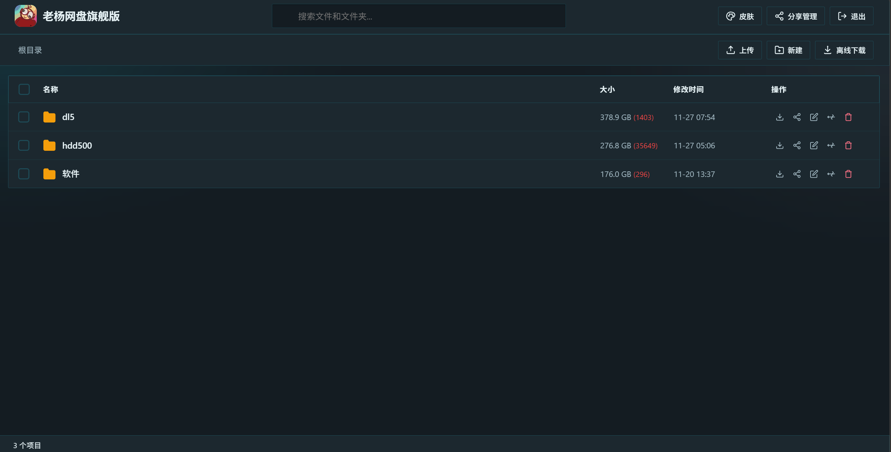
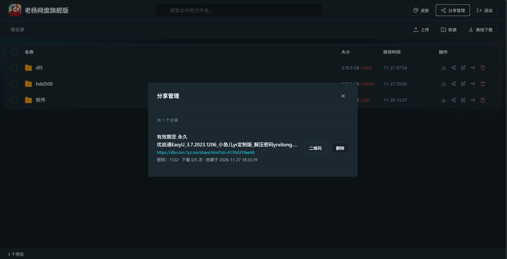
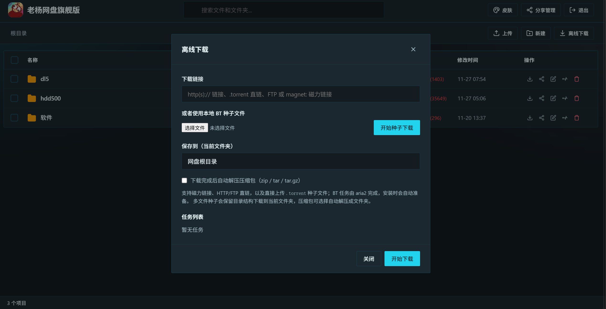
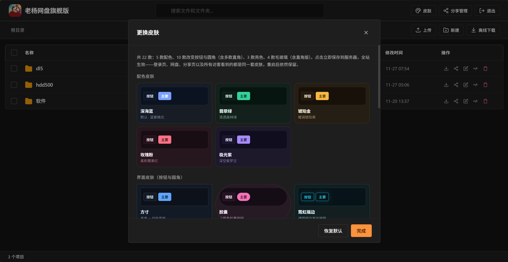
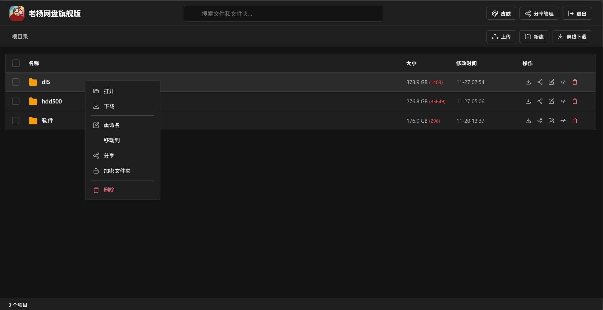
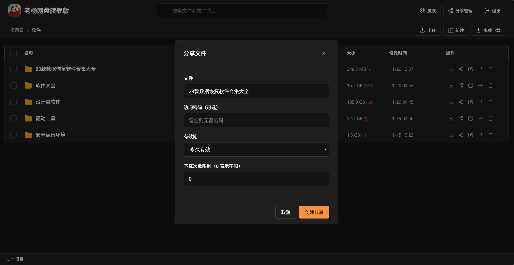
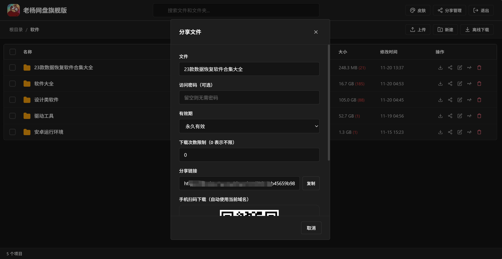
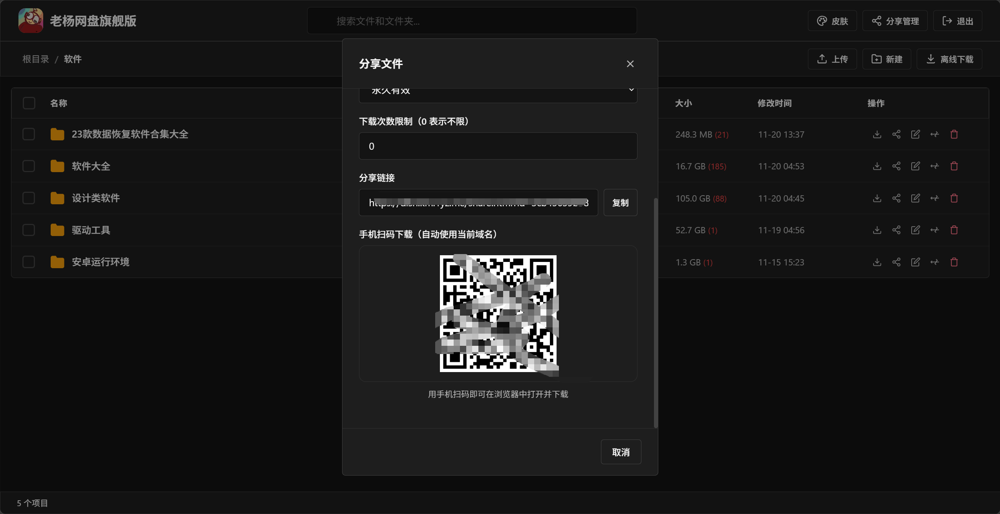
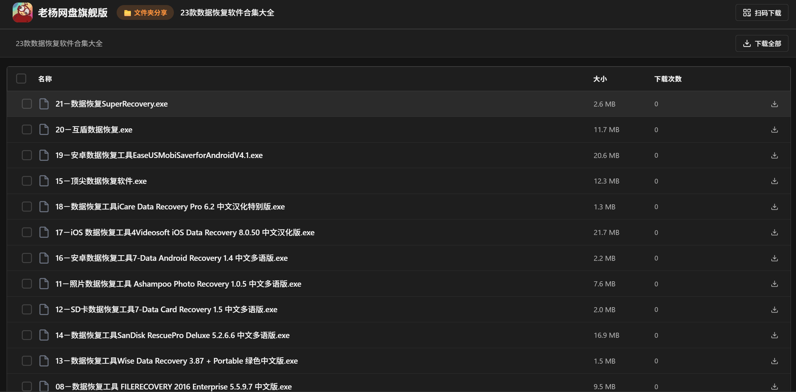
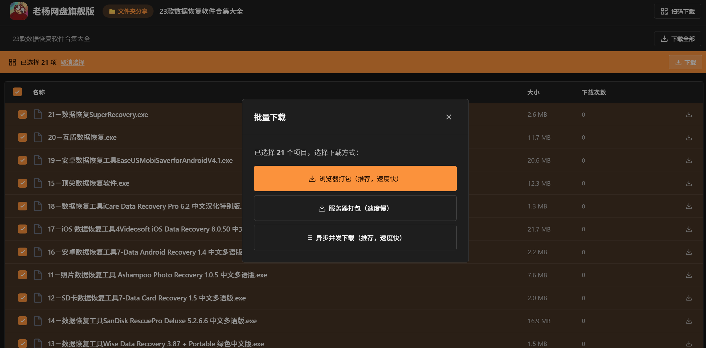

# LYWP · Go Netdisk（纯go版高性能网盘 / Pure Go High-Performance Netdisk）

[](LICENSE)
[](https://go.dev/)
[](https://www.debian.org/)
[](https://github.com/yztcsn/lywp-go/releases)

English · [简体中文](README.md)

A lightweight personal netdisk written purely in Go. It runs as a **single binary with no dependency on PHP, Nginx, or MySQL**, using SQLite for shares, sessions, and offline download tasks. The front end is inherited from the original PHP version, so the look and feel stay familiar.

Ideal for quickly setting up a private file hub on a single Debian 12 machine for personal, family, or small-team use.

---

## Screenshots

| Main UI (file list) | Share management |
| :---: | :---: |
|  |  |

| Offline downloads (HTTP / magnet / BT) | 22 themes |
| :---: | :---: |
|  |  |

| Context menu (open / download / rename / move / share / encrypt / delete) | Create share (password / expiry / download limit) |
| :---: | :---: |
|  |  |

| Share link and QR code | Scan QR to download on mobile |
| :---: | :---: |
|  |  |

| Browse shared folders with download counts | Batch download (browser ZIP / server ZIP / async parallel) |
| :---: | :---: |
|  |  |

---

## Features

- **Zero-dependency runtime**: one binary + one config file, no PHP / Nginx / MySQL needed
- **Install and go**: interactive `install.sh` asks for name, storage root, port, and password, then registers a systemd service for auto-start
- **Complete file management**: browse / create folders / upload files and whole folders / download / rename / move / delete / search / right-click menu / multi-select batch actions
- **Streaming media playback**: videos and audio stream via HTTP Range with instant seeking; works on both the main site and share pages without buffering the whole file
- **Share links**: optional password, expiry, and download limit; QR codes, direct links, share management; per-file download counts on folder shares
- **Offline downloads**: http / https / FTP / magnet / `.torrent`; server-side streaming or aria2, with optional auto-extract
- **Folder encryption**: right-click to encrypt; the password is stored as a salted hash and a password is required to enter the folder
- **22 themes**: switch from the top bar; the choice is saved server-side and applied globally to the login page, netdisk, share pages, and all visitors, persisting across restarts
- **Large-file optimization**: constant-memory streaming upload with 4 parallel connections; downloads over 256 MiB are handed to the browser's native download manager instead of buffering in memory
- **No limits**: no file size limit; shares and login sessions are valid indefinitely by default
- **Self-contained**: customize the storage root at install time; the database is kept separate from your netdisk files

---

## Quick Install (Debian 12)

Root privileges are required. Download the binary package from Releases, extract it, then run:

```bash
sudo bash install.sh
```

The script prompts for:

1. Site name (shown in the page header)
2. **Storage root** (default `/var/lib/lywp/files`; any writable directory works, e.g. `/mnt/nas/mydisk`; created automatically if missing)
3. Listen port (default `8080`)
4. Access password (hidden input, confirmed once)

Then visit `http://SERVER_IP:PORT/` and open the firewall port if needed:

```bash
sudo ufw allow 8080/tcp
```

### Unattended install

Pre-fill values with environment variables for automation:

```bash
sudo env SITE_NAME=MyNetdisk \
  LYWP_STORAGE_ROOT=/mnt/disk/mydisk \
  PORT=8080 \
  LYWP_PASSWORD=123456 \
  bash install.sh
```

> ⚠️ The storage root cannot be a system directory such as `/`, `/etc`, or `/var`, nor contain the internal data directory `/var/lib/lywp` (otherwise the database would appear as a netdisk file).

### Build from source

With Go 1.22+ installed:

```bash
CGO_ENABLED=0 go build -trimpath -ldflags="-s -w" -o bin/lywp-server-linux-amd64 .
sudo bash install.sh
```

`install.sh` prefers the prebuilt binary for the matching architecture under `bin/`, and falls back to compiling with local Go if none is found.

---

## What Gets Installed

| Path | Description |
| --- | --- |
| `/opt/lywp` | Source code and the `lywp-server` executable |
| The storage root you chose | Netdisk root; all uploads land here (default `/var/lib/lywp/files`) |
| `/var/lib/lywp` | Internal data: `lywp.db` SQLite database and temp files |
| `/etc/lywp/config.json` | Config (password hash only, mode 700) |
| `/etc/systemd/system/lywp.service` | systemd service for auto-start |
| `/usr/local/bin/lywp` | Shortcut command |

---

## Shortcut Commands

```bash
lywp start                 # Start
lywp stop                  # Stop
lywp restart               # Restart (lywp resatrt also works)
lywp status                # Show status
lywp log                   # Follow logs (Ctrl+C to exit)
lywp log --no-follow       # Show the last 200 lines only
```

---

## Feature Details

### Share links

When creating a share you can set:

- **Password**: visitors must enter it to view the share
- **Expiry**: the link stops working after the chosen date (`expire_days=0` means never)
- **Download limit**: e.g. `20` makes the link expire right after the 20th completed download. Counting happens on real server-side download requests; page refreshes and Range resumes do not double-count

For folder shares, a "Downloads" column shows the cumulative count per file (folders show the sum of all files beneath them).

### Offline downloads

Open the task panel from the "Offline Download" button in the toolbar:

- Supports `http://`, `https://`, `ftp://`, `magnet:`, and `.torrent` direct links; local `.torrent` files can be uploaded too
- Tasks save to the current folder by default; the panel shows progress and supports cancel, retry, and delete
- http/https files are streamed by the server directly; archives can be auto-extracted
- Magnet / torrent / FTP tasks are handled by `aria2c`, installed automatically by the setup script; if removed, the service reinstalls it on root at first use. On servers without internet or apt access, run `sudo apt-get install -y aria2` manually

### Folder encryption

Right-click a folder and choose "Encrypt folder", then enter the password twice. The server writes a hidden `.encry` file inside the folder containing a salted SHA-256 hash (never plaintext), which is excluded from listings, search, and ZIP downloads. Entering the folder requires the password; an unlock lasts 24 hours in the current session. If you forget it, delete the folder's `.encry` file on the server.

### Themes

The "Theme" button in the top bar offers 22 skins (color schemes, square/rounded corners, light/dark, frosted glass, etc.). The selection is written to `config.json` and applied globally by the server: the login page, netdisk, share pages, and all visitors see the same theme, which persists across restarts.

### Modification time

A folder's modification time is computed recursively: any change—edit, upload, delete, or move—to a file or subfolder at any depth updates the folder's time to the newest one among its contents.

---

## Transfers and Concurrency

- **No size / time limits**: uploads are streamed to disk (4 MiB buffer); shares are permanent by default
- **Parallel uploads**: up to 4 files at once; folder uploads share the same task pool
- **Parallel downloads**: the server supports Range resume; files over 256 MiB go straight to the browser's download manager to avoid memory spikes
- **Database concurrency**: SQLite WAL + `synchronous=NORMAL` with up to 8 connections; download counts use a conditional UPDATE so limits hold under concurrency
- **ZIP optimization**: already-compressed formats (jpg / png / mp4 / mkv / zip, etc.) use Store instead of Deflate; archives are saved via native browser streaming

---

## Local Development

```bash
# Generate a config (you can also run `go run . hash <password>` to make a hash alone)
LYWP_CONFIG=/tmp/lywp/config.json \
LYWP_NAME=LYWP \
LYWP_PORT=8080 \
LYWP_PASSWORD=123456 \
LYWP_DATA_DIR=/tmp/lywp/data \
LYWP_STORAGE_ROOT=/tmp/lywp/mydisk \
go run . init-config

go run . serve --config /tmp/lywp/config.json
```

Cross-compile:

```bash
CGO_ENABLED=0 GOOS=linux GOARCH=amd64 go build -trimpath -ldflags="-s -w" -o lywp-server-linux-amd64 .
CGO_ENABLED=0 GOOS=linux GOARCH=arm64 go build -trimpath -ldflags="-s -w" -o lywp-server-linux-arm64 .
```

---

## Project Structure

```
.
├── main.go                # Entry point, static assets, graceful shutdown
├── config.go              # Config I/O, password hashing
├── store.go               # SQLite: shares, download counts, sessions, offline tasks
├── fs.go                  # Path safety, file listing, ZIP streaming
├── handlers.go            # Native /api/* endpoints
├── compat.go              # api.php / auth.php compatibility layer for the original front end
├── encryption.go          # Folder .encry encryption and unified path validation
├── offline.go             # Offline download tasks and aria2 integration
├── storage_linux.go       # Linux disk space stats
├── storage_other.go       # Non-Linux development fallback
├── web/                   # Front end: index.html / share.html / theme.css / logo / static JS
├── bin/                   # Prebuilt Linux binaries (amd64 / arm64)
├── install.sh             # Installer
└── uninstall.sh           # Uninstaller
```

---

## Uninstall

```bash
sudo bash uninstall.sh             # Remove the program and service, keep files in the storage root
sudo bash uninstall.sh --purge -y  # Also wipe the custom storage root and internal data (irreversible; the directory itself is kept)
```

---

## License

[GPL-3.0](LICENSE) © yztcsn
